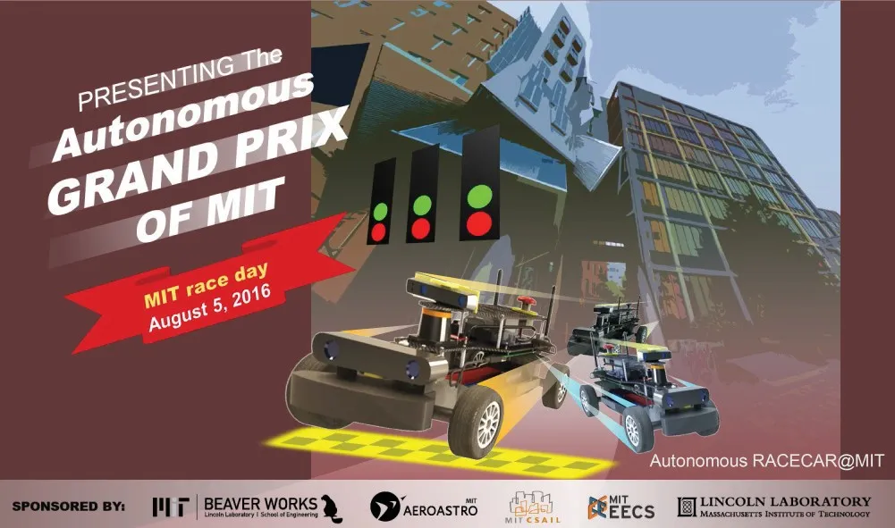

## 1. Introduction & Overview

**MIT RACECAR** (Rapid Autonomous Complex-Environment Competing Ackermann-steering Robot) is an open-source 1/10-scale autonomous vehicle platform from MIT Lincoln Laboratory’s Beaver Works Initiative, built with the Departments of Aeronautics & Astronautics and LIDS. Its flagship course runs each summer in the **Beaver Works Summer Institute (BWSI)**, an intensive four-week STEM program where high school students progress from a virtual twin simulator to programming physical racecars.

---

## 2. Instructional Roles & Publications

My work with the MIT RACECAR platform spanned two complementary roles, where my responsibilities evolved from supporting the Robotics: Science and Systems (RSS) course to leading instruction at the Beaver Works Summer Institute (BWSI). I also used the curriculum I developed for these courses to author a Model AI assignment.

### 16.405/6.141 Robotics: Science and Systems (RSS) – Teaching Assistant
As TA for the RSS course with Sertac Karaman, I focused on the technical foundations of the course and direct student guidance.
- **Curriculum & Support:** I developed course labs—including the visual servoing lab—and provided student teams with the starter code and technical assistance they needed to navigate the semester.
- **Instruction:** I delivered one unrecorded lecture for the class.

### Beaver Works Summer Institute (BWSI) – Lead Associate Instructor
As the Lead Associate Instructor for the BWSI RACECAR summer course, my role transitioned to program management, curriculum design, and formal instruction.
- **Instructional Leadership:** I managed the team of Associate Instructors, coordinated team support, and handled the logistical side of the program, such as lab scheduling and mapping subject titles to the course calendar to ensure consistency.
- **Curriculum Development:** I developed comprehensive lab handouts for the course.
- **Lecturing:** I delivered two recorded lectures as part of the formal syllabus:
  - **Visual Servoing** (July 20, 2017)
  - **Navigation** (July 27, 2017)

### Model AI Assignment (AAAI/EAAI Publication)
As one of the course instructors, I was asked to develop the visual servoing laboratory assignment. I then submitted the curriculum to the Model AI Assignments workshop—part of the Educational Advances in Artificial Intelligence (EAAI) symposium at the AAAI Conference—where I also presented these educational materials and methodologies.

| Specification | Details |
| :--- | :--- |
| **Project Link** | [Model AI: Visual Servoing Assignment ↗](https://modelai.gettysburg.edu/2017/visual-servo/index.html) |
| **Core Technologies** | Python, C++, OpenCV, and ROS |
| **Assignment Focus** | Image-Based Visual Servoing (IBVS), orange cone detection and parking, monocular camera line-following, closed-loop proportional control |

---

## 3. The Hardware Platform

The RACECAR vehicle platform combines high-performance compute with agile physical dynamics to create a robust research and educational testbed:

- **Compute:** NVIDIA Jetson embedded GPU platform running Ubuntu and ROS (Robot Operating System).
- **Sensing:** Hokuyo 2D LIDAR, ZED Stereo Camera, and IMU telemetry.
- **Actuation:** VESC electronic speed controller and brushless DC motor on a 1/10th scale rally chassis with Ackermann steering.

---

## 4. Core Curriculum & Lecture Series

I delivered two recorded lectures as part of the formal syllabus:

- **Visual Servoing** (July 20, 2017) — [Watch on YouTube ↗](https://www.youtube.com/watch?v=bAAatB2IvUM#no-embed)
- **Navigation** (July 27, 2017) — [Watch on YouTube ↗](https://www.youtube.com/watch?v=CdRs0l9f5WM#no-embed)

---

## 5. Project Demonstrations & Competition

The practical side of the RACECAR curriculum culminates in student demonstrations and a high-speed, autonomous racing competition.

### 🎥 Part A: Line Following Demonstration

Closed-loop proportional control tracking paths using monocular camera input.

---

### 🎥 Part B: Cone Tracking & Visual Servoing

Real-time visual tracking, color isolation, and safety-limited collision avoidance.

---

### 🎥 Main RACECAR Challenge Demonstration
An intensive final-day speed loop challenge where 1/10th scale autonomous racecars navigate complex indoor corridors. Vehicles must perform real-time visual servoing, LIDAR-based obstacle avoidance, and precise wall-following to achieve rapid lap times without collision.

---

### Educational Impact & Competition

Students culminated their intensive workshop by programming the cars to perform a variety of tasks—including pure pursuit, SLAM, and visual servoing—and competing in an autonomous race through complex indoor hallways and obstacle courses, showing integrated software running on real hardware.
