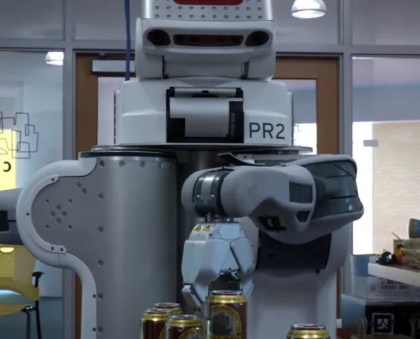

## Decentralized Autonomous Logistics in Dynamic Human Environments

**Delivery Bots** tackles multi-robot package delivery within complex, populated indoor environments (such as university campuses and hospital corridors) where human motion and task durations are highly uncertain.

To demonstrate the system in action, I converted the MIT CSAIL lab into a miniature "bar" featuring a PR2 robot "bartender" and two Turtlebot "waiters". As demo lead, I ran the live demonstration: decentralized robots coordinating over intermittent communication.

### Decentralized Beerbot Handoff & Delivery Demonstration
A PR2 robotic bartender prepares and hands off a beverage to a Turtlebot delivery agent, which then autonomously navigates dynamic human obstacles to deliver:

---

## Research Significance & Honors

- **Demo Leadership & Awards:** Led the live project demonstration and won 2nd place at the **CSAIL Research Highlights (Spring 2015)**.
- **RSS 2015 Best Paper Finalist:** Recognized at the *Robotics: Science and Systems (RSS)* conference in Rome, Italy.
- **IJRR Journal Publication:** Expanded into a journal paper (submitted Dec 2015, revised Jun 2016).
- **Authorship:** Authored alongside Christopher Amato, George Konidaris, Gabriel Cruz, Jonathan P. How, and Leslie P. Kaelbling under the paper title *"Policy Search for Multi-Robot Coordination under Uncertainty"*.

---

## Core Technical Challenges

Multi-agent coordination in shared human spaces suffers from severe unpredictability:
1. **Dynamic Human Obstacles:** Pedestrians temporarily block hallways, slow down delivery routes, or interact unpredictably with vehicles.
2. **Task Duration Uncertainty:** Item pickup and handoff times vary widely based on human availability and response time.
3. **Communication Latency & Drops:** Centralized controllers fail when network bandwidth drops or when agents move into wireless dead zones.

---

## Algorithmic Architecture & System Design

To solve these challenges, the team developed the MacDec-POMDP algorithm using macro-actions and finite-state controllers for general multi-robot coordination under uncertainty:

### 1. Decentralized Task Allocation
- Robots negotiate task assignments locally without requiring continuous connection to a central server.
- Formulation incorporates probabilistic models of route traversal times and human delays.

### 2. Macro-Action Planning under Uncertainty
- Replaces primitive motion commands with high-level macro-actions (e.g., "Navigate to Room 320 via East Hallway").
- Evaluates risk-aware belief states to dynamically re-route around crowded hallways or stalled elevator banks.

### 3. Real-World Autonomous Deployment & Fleet Integration
- Managed the end-to-end design and deployment of the autonomous multi-robot delivery fleet, covering hardware integration, locomotion, and the decentralized planning stack.
- Collaborated with the CSAIL Machine Shop to mount coolers onto the TurtleBots.
- Built hard-wired interaction buttons integrated with an Ubuntu-based system using the espeak library for verbal interaction.
- Evaluated on a fleet of autonomous mobile robots operating in MIT building corridors over multi-day deployment trials.
- Demonstrated robust package delivery throughput despite unexpected corridor blockages and variable human interaction delays.

---

## In the news

The project drew public interest: beer delivery is a fun, relatable proxy for testing multi-robot algorithms meant for critical logistics — medical-supply transport, disaster zones.
- **Featured in MIT News & National Media:** Highlighted across outlets like the *Los Angeles Times*, *HuffPost*, *Popular Science*, and *UPI* for advancing real-world multi-agent coordination.
- **A Legislative Milestone:** The project achieved unexpected fame when U.S. Senator Jeff Flake introduced an amendment to the Department of Defense appropriations bill specifically targeting the research to ban federal funding for "beerbots and other robot bartenders"—cementing its unique place in both robotics history and legislative trivia.
