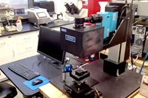

## Laboratory Sustainability & Telemetry Infrastructure

The **Lab Energy Assessment Center (LEAC)** project ([leac-mit.github.io](https://leac-mit.github.io/)) built networked telemetry to track and cut energy use across MIT research labs. As lead technology developer, I designed the project's website, wrote the initial core telemetry prototypes (`green_net`), and mentored undergraduate researchers who conducted comprehensive energy assessments across campus labs.

---

## The Challenge: Laboratory Energy Intensity

MIT buildings containing research laboratories consume over 300% more energy per square foot than non-lab academic facilities. Variable Air Volume (VAV) fume hoods, high-powered equipment, and constant lighting draw massive electrical and HVAC loads. For example, a single open fume hood sash can draw as much conditioned air as multiple average American homes, costing thousands of dollars per year in wasted energy.

Laboratory managers and sustainability teams were flying blind on equipment power draw, unutilized open sash positions, and campus-wide energy waste. Low-cost, automated telemetry gives them that visibility.

---

## System Architecture & Software Implementation

I built and deployed a monitoring platform for academic labs:

### 1. Smart Outlet Network Monitoring (`green_net`)
- Developed Python-based telemetry scripts using the Ouimeaux API to interface with smart plugs (such as WeMo Insight switches), scanning local networks, querying real-time power draw, and outputting structured time-series logs (`data.csv`).
- Designed the initial data logging architecture and command-line execution flows to capture high-frequency power measurements.

### 2. Computer Vision State Detection
- For hardwired laboratory equipment such as fume hoods and overhead lighting — places smart plugs can't reach — we incorporated lightweight computer vision pipelines to identify on/off states and sash positions.

---

## Student Mentorship & Program Execution

Following initial prototype development, I worked closely with the team—including co-founders, EHS liaisons, and undergraduate researchers—to support campus-wide audits:
- **Mentorship:** Guided undergraduate team members (such as Dheekshita Kumar, Juan Ferrua, and Maxwell Drake) in configuring hardware, managing data logging repositories, and analyzing lab power draw.
- **Collaborative Research:** This work contributed to broader campus sustainability frameworks and publications, including collaborative findings detailed in *Energy Reports* (Becerra et al., 2018).

---

## Grant Recognition & Impact

- **MIT Green Labs Innovation Award:** Recognized with the 2017 Innovation Award ($5,000) for developing sustainable campus technology.
- **Actionable Telemetry:** Provided free, minimally invasive energy audits and data-driven recommendations to campus research groups, a repeatable model for lab decarbonization.
